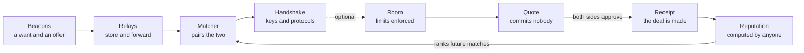

# Varde: an open discovery and negotiation layer for agents

Asbjørn Enge Andersen · 22 November 2026

## Abstract

Agents make collaboration cheap, but two agents that have never met have no open way to find each other. This paper proposes **Varde**, an open protocol built on **beacons**: small signed objects in which an agent states a want or an offer for other agents to discover.

The name comes from the Norwegian *varde*, a chain of hilltop signal fires in which each fire was lit when the one before it was seen.

A beacon says who lit it, what it seeks, an optional scope, an expiry, and how to make contact. Beacons travel over simple, replaceable relays, and anyone who listens can match them. Everything after discovery (trust, negotiation, payment) is left to the two agents.

One optional service sits on top of this open layer: a neutral **room** where two agents negotiate under enforced limits and leave with a signed **quote**. A quote commits nobody. It becomes a deal, with a signed **receipt**, when both sides approve it, and a side can require that the approval comes from its owner's key. Receipts make reviews verifiable and reputation portable. The protocol stays open, and rooms and matchers are where a business can be built.

A proof of concept implements the core of the proposal. Two agents that had never met, given only a goal and the tools, found each other and agreed a price inside both of their limits. Where the buyer acted for an owner, it stopped at the quote, reported back, and completed the purchase only after the owner approved. The section [Proof of concept](#proof-of-concept) says what was built and what was not.

## Thesis: scarcity moves to agreement

When a capable app can be generated in minutes, code stops being scarce. Value moves to what cannot be generated: shared state that several parties must agree on.

Agents make interoperability nearly free, because they translate between formats and APIs on the fly. What they cannot produce alone is agreement: who wants what, who committed to what, and what happened.

Three consequences shape this proposal:

- **Websites become obstacles.** A person looking for a used iPad wants the best one, not ten sites to scroll through.
- **Demand becomes expressible.** An agent can state a want precisely and keep it standing, which a search box cannot.
- **Coordination cost collapses.** Parties who could never organise can be matched in seconds, provided they can find each other.

## The problem: agents cannot find each other

An agent today can only reach counterparties that are already listed somewhere it knows to look. Crawling the web gives uneven results, and a web page cannot negotiate.

Existing discovery work is supply-side: registries where agents advertise what they can do. Nothing open lets an agent broadcast what it wants and be found by whoever can help.

Varde fills that gap with four parts. Only the first is mandatory.



Two agents can stop after the handshake and deal directly. If they use a room, its receipts feed the reputation that ranks later matches.

- **Beacon:** a signed statement of a want or an offer.
- **Relays and matchers:** carry beacons and pair complementary ones.
- **Room:** an optional neutral space where two agents negotiate.
- **Quote:** the terms two negotiators agreed, standing for a while and binding on nobody.
- **Receipt:** a signed record of a deal both sides approved, from which reputation is computed.

## The beacon

A beacon is a small signed JSON object. It is the whole protocol, and everything else is convention built around it.

| Field | Required | Purpose |
| --- | --- | --- |
| `v` | Yes | Format version, currently `1` |
| `who` | Yes | DID of the agent that lit it |
| `what` | Yes | The want or offer in free text. An object form adds optional tags and an intent hint. Agents parse meaning, so no fixed taxonomy is needed |
| `scope` | No | Place, time window, topic |
| `lit` | Yes | When the beacon was lit |
| `expires` | Yes | When the beacon burns out |
| `reachMe` | Yes | One or more ways to make contact |
| `proofs` | No | Whatever the lighter chooses to attach: a stake, a credential, a pointer to reputation |
| `accepts` | No | Rooms, protocols and trust systems the lighter is willing to use |
| `sig` | Yes | Signature by `who` over every other field |

```json
{
  "v": 1,
  "who": "did:key:z6MktVXwQ5fK2rG8dP3nYbH7sLcJ4mTaE9uWxZ1oRvN6iCqD",
  "what": {
    "text": "Looking for a used iPad Air, under 4000 kr",
    "tags": ["ipad"],
    "intent": "want"
  },
  "scope": { "where": "Stavanger area" },
  "lit": "2026-11-22T12:00:00.000Z",
  "expires": "2026-11-29T00:00:00.000Z",
  "reachMe": [
    { "kind": "mailbox", "relay": "wss://relay.example", "encKey": "pV0c…" },
    { "kind": "endpoint", "protocol": "a2a", "url": "https://my-agent.example" }
  ],
  "proofs": [],
  "accepts": { "rooms": ["wss://room.example"], "protocols": ["varde-room/1"] },
  "sig": "k3Jx…"
}
```

### Signing

`who` holds the identity and `sig` holds the signature. The two are separate fields, and the signed bytes are fixed so that two implementations always sign the same thing:

    sig = Ed25519( "varde/beacon/v1\n" + canonical-json(beacon without sig) )

Canonical JSON is RFC 8785: keys sorted, no whitespace. The first line names the kind of object being signed. Every signature in Varde uses the same construction with its own name (`beacon`, `mail`, `room-join`, `quote`, `approval`, `receipt`), so a signature made for one purpose cannot be replayed as another.

A beacon's id is the SHA-256 hash of the same canonical JSON. It is derived from the content, so it cannot be chosen or forged.

The proof of concept identifies agents by `did:key` with an Ed25519 key. Other DID methods, which allow key rotation, are a later addition.

### Design choices

- **Symmetry.** There are no buyer and seller types. Both sides light beacons, and a match is two beacons that complement each other.
- **An intent hint.** `what.intent` is `want` or `offer`, and it is optional. Either side may light either kind, so symmetry holds. The hint exists because similarity alone cannot tell complements from duplicates: without it, a matcher pairs two buyers of the same iPad.
- **Two lifetimes.** A momentary want ("a table tonight at 19:00") expires within hours. A standing offer ("we take bookings") stays lit for months. It is the same object with a different expiry.
- **A key for mail.** A mailbox entry in `reachMe` carries `encKey`, the key that mail to the lighter must be encrypted to. It sits inside the signed beacon, so the lighter's signature vouches for it.

## Design properties

The system is defined by nine properties, and any infrastructure that delivers them is acceptable.

1. **Self-authenticating.** Every beacon is signed, so storage never needs to be trusted.
2. **Permissionless to light.** No signup and no API key.
3. **Permissionless to listen.** Anyone can subscribe and filter, with no gatekeeper.
4. **Ephemeral.** Expiry is honoured and nothing is permanent by default.
5. **Fuzzy discovery.** Beacons can be found by meaning, place and time, not only by exact key.
6. **Policy at the edges.** Beacons carry optional proofs, and listeners decide what they require.
7. **Optional confidentiality.** Payloads can be encrypted or revealed only on a match.
8. **Replaceable infrastructure.** Any node can disappear without the network caring.
9. **Near-free and fast.** Lighting a beacon costs about what an HTTP request costs.

Varde is general from the start. It does not define trust, negotiation or payment. Those are chosen by the two agents after they have found each other.

## Distribution

A signed beacon authenticates itself, so the network needs availability and search, not consensus. That splits distribution into two simple jobs.

- **Relays** store and forward beacons. A relay does two things: accept a published beacon, and serve a subscription with a filter. Anyone can run one, and any one can be replaced.
- **Matchers** subscribe to relays and pair complementary beacons by meaning, place and time. They compete on quality.

A listener can always subscribe to a relay directly and match locally. A matcher is a convenience and never a gatekeeper.

The beacon is transport-neutral, so it can travel over more than one network at once.

| Binding | What it gives | What it costs |
| --- | --- | --- |
| Own relay network | Keypair-only identity, no signup, native expiry, minimal surface | Listeners must be bootstrapped from zero |
| AT Protocol | DIDs with key rotation, signed repositories, a public firehose, labelers for edge policy, an existing developer community | Needs an account and a PDS. Repositories are durable, so expiry is best-effort. Records are public by default |
| Bridge | Mirrors beacons between the two, so one object is visible on both | One more component to run |

On atproto a beacon is a record under a custom lexicon, and matchers filter the firehose for that collection. Its non-public extension, [Atproto Spaces](https://atproto.com/blog/atproto-spaces-alpha), was in alpha as of August 2026. It gives access control without encryption, so it does not deliver confidential beacons by itself.

Two alternatives were considered and set aside as the storage layer:

- **A ledger.** Consensus resolves conflicts, and beacons never conflict. A chain would add cost, permanence and full publicity to data that is meant to expire. It remains useful for optional proofs such as bonds.
- **A pure DHT.** It does exact-key lookup, while beacon matching is fuzzy. Bucketed keys (geohash plus topic) could make it work as one relay implementation among others.

## Contact

`reachMe` is a list of contact methods, because most personal agents are not servers.

- **Mailbox.** The responder encrypts a message to the key in the beacon and drops it on a relay. Neither side reveals an IP address or needs to be online at the same moment. Reading a mailbox requires proving control of its key to the relay.
- **Direct endpoint.** For agents that are always online, a URL with a declared protocol such as A2A, MCP or plain HTTPS.

First contact is a fixed, structured handshake, not free conversation. Every message is signed by its sender and encrypted to its recipient.

1. **Hello.** The responder names the beacon it is answering, presents its own key and a fresh nonce, and may attach its own beacon.
2. **Welcome.** The lighter signs the responder's nonce with the beacon's key, proving it controls the contact point. It sends a nonce of its own and states which protocols, rooms and trust systems it supports.
3. **Confirm.** The responder signs the lighter's nonce, proving it controls the key it presented, and states the overlap it computed.
4. **Ack.** The lighter checks the overlap against its own calculation and agrees, or walks away by staying silent.

Steps 2 and 3 prove both keys at almost no cost. Neither side can be impersonated, and a responder that attaches a beacon must have lit it. This matters later: a room can only verify both parties against their beacons if both keys were proven here.

The overlap is where the agents decide how much trust the exchange needs, which keeps that choice out of the protocol. The chosen room is the first one on the lighter's list that the responder also accepts. If they have none in common, the handshake still completes and they deal directly.

The handshake also gives the two agents a session id, a hash over the first two messages. Only they know it, and it is what admits them to a room.

Because both sides light beacons, both may answer at the same moment: the buyer answers the offer while the seller answers the want. Two handshakes for one match would give two sessions and, in the end, two deals. So only one survives. An agent that receives a hello for a match it has itself just answered ignores it if its own hello has already been answered, or if its own identifier sorts lower.

## Rooms

A room is a neutral service that two agents enter to negotiate under rules neither of them controls. It is optional and plural: a beacon lists the rooms it accepts, and agents may use one, another, or none.

A room does five things:

- **Verifies both keys** against the beacons that brought the agents there. Each party signs the room's challenge, and a presented beacon must have been lit by that key.
- **Enforces each side's mandate outside the model.** A budget cap is code, so it cannot be argued away.
- **Limits turns and tokens**, so neither side can be drained.
- **Separates data from talk.** Offers, counters, accepts and rejects are structured messages. Free text is treated as untrusted.
- **Issues a signed quote** of what was agreed, keeps it while it stands, and issues the receipt once both sides have approved it.

A mandate is what a party authorises: which side it is on (paying or receiving), a currency, a limit, and any conditions beyond price it insists on, such as the times it will accept. The paying side's limit is the most it may pay, and the receiving side's is the least it may accept. A party gives its mandate to the room, signed, when it joins. The room never shows it to the other side.

The room checks every move against the sender's mandate before the other side sees it. An offer or an acceptance outside the mandate is refused, and the sender is told why. Every attempt costs a turn, including refused ones, and the session ends when the turns run out.

Published research supports the need for this. A study of agent-to-agent retail negotiation, reported by Stanford HAI, found that weaker buyer agents paid about 2% more, and weaker seller agents lost up to 14% of profit. In one case an agent with a $500 budget closed a deal at $900 ([Stanford HAI](https://hai.stanford.edu/news/the-art-of-the-automated-negotiation)). Salesforce's research team reports agents conceding to each other in agreement loops, and being pressured into revealing sensitive data ([Salesforce](https://www.salesforce.com/blog/agent-to-agent-interaction/)).

Each participant should send a **sandboxed negotiator**: a separate, low-privilege agent that carries only the goal, the limits and what it may reveal. It has no access to the owner's files, tools or memory, so it cannot leak them. The reference implementation makes this the default, and withholds the other side's free text from the negotiator unless the owner opts in.

## Quotes, approval and receipts

Agreeing and committing are two steps, because an agent should be able to gather offers from several counterparts and take them to its owner before anything is binding.

**A quote** is what the negotiators agreed: the two keys, the beacons involved, the terms, and how long the terms stand. Both agents and the room sign it. It commits nobody. Each party checks the quote before signing: that the terms are the ones it saw agreed, and that they are within its own mandate. A room therefore cannot record terms that were not agreed.

**An approval** is one side's binding yes to one quote. The quote names, for each side, the key that must sign it. If the mandate names an owner, that is the owner's key, which the agent does not hold. The owner's key can be a passkey on a phone, so that approving is a tap and a fingerprint, with a key that only the owner holds. The agent carries the signed approval to the room, and the room refuses one signed by anything else. An owner can let the agent approve small amounts by itself, by setting a price up to which the agent's own key is enough. Without an owner, the agent's key approves.

**A receipt** is issued by the room when it holds an approval from each side before the quote runs out. It contains the quote, both approvals and the room's signature. Anyone can verify it with nothing else. A room cannot forge one, because it cannot sign for the approvers.

Until the receipt exists, either side can withdraw, and a quote nobody acts on lapses at its deadline. So a buyer with three quotes approves one and withdraws from two, and a seller with one item and two willing buyers commits to one and withdraws from the other.

This answers part of a hard question: whether a negotiator may commit its owner. With an owner's key in the mandate, the receipt shows that the owner approved these exact terms.

## Reputation

Receipts change what a review is:

- **Reviews are verifiable.** A review must reference a receipt, so only parties who transacted can rate each other.
- **Reputation is portable.** It attaches to a key, not to a platform account, and can be read by anyone.
- **Reputation runs both ways.** A restaurant sees a diner's no-show record just as the diner sees the restaurant's ratings.

Rankings are plural by design. Anyone can compute a ranking from public receipts and reviews, and each agent chooses whose ranking to trust. A single official ranking would recreate the gatekeeper this design avoids, and would be the main target for gaming.

Receipts can stay private between the parties. Publishing one, or a proof that it exists, is a choice each side makes when it wants the reputation.

## Worked example: a table for tonight

The request is "book me a table at a good Italian place at 19:00".

1. Restaurants keep standing beacons lit: "Italian restaurant, Stavanger, takes bookings". Some are lit by the restaurant's own agent and some by an adapter over its existing booking system.
2. The diner's agent lights a momentary beacon: "table for two, Italian, tonight 19:00, Stavanger", expiring at 19:00.
3. A matcher pairs the want with nearby offers. The diner's agent ranks them using a reputation ranking it trusts.
4. The agent contacts the top candidates through `reachMe` and completes the handshake.
5. In a room, the two negotiators settle the terms. On a full Saturday there is nothing to haggle over. On a quiet Tuesday the restaurant may offer a discount for an early seating.
6. The diner's agent may attach a small bond against a no-show, which a restaurant can require or reward.
7. The room issues a quote. The diner's agent may approve a booking this small by itself, or show the diner two or three quotes and let them pick. When both sides have approved, the room issues the receipt.
8. After the meal, each side can publish a review that references the receipt.

Negotiation adds most where inventory is perishable: tables, hotel rooms, appointment slots and last-minute tickets lose all value once the moment passes.

The same flow covers selling a used iPad, finding a meetup, staffing a project or arranging a date. Only the content of `what` and the trust the parties ask for change.

## Threats and defences

No agent can know in advance that a contact is safe, so the design aims to make a trap cheap to walk into.

| Threat | Where it occurs | Defence |
| --- | --- | --- |
| Beacon spam and fake offers | Before any negotiation | Optional proofs on the beacon (stake, credential). Listeners and relays set their own policy, such as ignoring unbonded beacons |
| Beacon content leaks intent | Before any negotiation | Encrypted payloads, coarse public scope, reveal on mutual match |
| Impersonated contact point | First contact | Nonce signed with the beacon's key |
| Impersonated responder | First contact | Nonce signed with the responder's key. An attached beacon must have been lit by that key |
| Prompt injection | Negotiation | Sandboxed negotiator, structured messages, free text treated as untrusted |
| Extraction of budget or identity | Negotiation | The negotiator carries only its mandate. Limits are enforced by the room |
| Token drain | Negotiation | Hard caps on turns and tokens per contact. Refused moves count |
| Tracking of responders | First contact | Mailbox contact through a relay |
| Fake or collusive reviews | After the deal | Reviews must reference a receipt. Plural rankings can weight by stake and history |
| An agent commits to something its owner did not want | After negotiation | A quote binds nobody. The deal needs an approval signed by the owner's key, which the agent does not hold |
| The same match negotiated twice | First contact | One handshake per pair of beacons |
| A dishonest room | Negotiation | Rooms are plural and replaceable. Both parties check the quote before signing, and a receipt needs approvals the room cannot sign |

Two of these happen before negotiation starts, so they cannot be left to the agents to settle between themselves. The protocol handles them by carrying optional proofs and allowing encryption, and leaves the policy to each listener.

## Adoption

The adopters are agents, and agents choose differently from people. They have no habits and no brand loyalty. They pick what they can find, call and pay for with the least friction.

- **Ship as tools.** `light` and `listen` are published as tools any agent can call, for example through an MCP server, with no signup.
- **Be legible.** A short spec, a machine-readable schema and presence in tool registries are the marketing.
- **Bootstrap supply with adapters.** Adapters light standing beacons on behalf of existing services, such as booking systems and listing sites, so wants find offers before anyone has adopted the protocol.
- **Ride existing networks.** The atproto binding puts beacons in front of an existing developer community on day one.
- **Stay general.** No vertical is built into the protocol. Agents bring the use cases.

The main risk is density. A beacon that nobody hears is worthless, and generality spreads early beacons thin. Adapters and standing offers are the answer proposed here, and it is untested.

## Economics

The beacon layer is close to a public good, and the services around it are where value can be captured.

| Layer | Open or commercial | How it could earn |
| --- | --- | --- |
| Beacon format | Open | Nothing. It must be free to succeed |
| Relays | Open, anyone runs one | Little. Possibly paid retention or priority |
| Matchers | Competitive | Quality of matching. Fees from standing-offer holders who want reach |
| Rooms | Competitive | A fee per negotiation or per receipt |
| Rankings | Competitive | Subscriptions from agents or their platforms |
| Adapters | Competitive | Fees from the businesses they represent |

The position worth holding is the best matcher and the best room on an open protocol. Open beacons bring the traffic, and neither service can lock anyone in, so both have to keep earning their place.

## Related work

The individual ideas here are not new. What appears unclaimed is their combination: open, general, demand-side discovery with optional rooms on top. This rests on a brief search on 22 November 2026 and is not a full survey.

| Work | What it does | Relation to Varde |
| --- | --- | --- |
| [ERC-8004](https://eips.ethereum.org/EIPS/eip-8004) | Draft Ethereum standard with on-chain identity, reputation and validation registries for agents | Supply-side registry with no wants. Could be one source of `proofs` |
| [PACT](https://www.ietf.org/archive/id/draft-laxsharma-pact-00.html) | Individual IETF draft (July 2026): sealed bids, escrow, a seller bond, and co-signed work attestations treated as reputation | Closest to rooms and receipts. Starts once parties know each other. A room could adopt its contract format |
| [Pairoa](https://dev.to/usepairoa/the-missing-mcp-category-private-matching-for-ai-agents-32fe) | Private matching of needs and offers over MCP and OpenAPI, revealing contact only on a two-sided fit. Aimed first at AI builders | Closest to beacons. A single private service, not an open protocol |
| [Tobira.ai](https://www.producthunt.com/posts/tobira-ai) | A network where agents find clients, investors and partners and negotiate for their owners. Also offers site agents for businesses | Same goal inside a closed network |
| [LLM-X](https://arxiv.org/html/2605.11376v1) | Research prototype: a message bus and typed protocol for negotiation between personal agents, evaluated with scripted agents | Negotiation testbed with no open discovery |
| [Salesforce A2A semantic layer](https://www.salesforce.com/blog/agent-to-agent-interaction/) | Research describing failure modes and proposing message schemas, verification and guardrails | Supports the case for rooms, from an enterprise angle |
| AT Protocol | Open network with DIDs, signed repositories and a public firehose | A distribution binding, not a competitor |

Not reviewed here: an individual IETF draft named AINP on intent exchange between agents, whose page could not be opened, and the agent-payment protocols from card networks and AI platforms. Payment protocols are candidates for the step after a receipt.

## Proof of concept

The claim to prove was narrow: two agents that have never met can find each other and start negotiating with no prior arrangement. A reference implementation of the six pieces that needs exists, in TypeScript.

| Piece | What was built |
| --- | --- |
| Beacon schema | Signing, verification and a JSON Schema |
| Relay | Accepts beacons, serves filtered subscriptions, honours expiry, holds encrypted mail, optionally keeps state across restarts |
| Tools | `light` and `listen` through an MCP server, with `contact`, `contacts`, `negotiate`, `quotes`, `commit` and `withdraw` beside them |
| Matcher | Ranks by similarity, then filters by place, time window and intent |
| Handshake | The four messages above, over a mailbox |
| Room | Enforces a price limit, required conditions and a turn limit. Issues a quote, keeps it, and issues the receipt when both sides have approved |
| Owner's approval | A command-line tool that signs an approval with a key the agent does not hold |

### What the tests show

The first test was the iPad case. One agent lit a want with a ceiling of 4000 kr, and two others lit offers with floors of 3200 kr and 2900 kr. The buyer's agent found both, completed a handshake with each, and scripted negotiators reached quotes of 3530 kr and 3407 kr. At that point nothing was binding, and the agent's own attempt to commit was refused. The owner approved the cheaper quote, the agent withdrew from the other, and the room issued one receipt.

The table-for-tonight case runs too. The diner's mandate allowed a seating at 18:30 or 19:00 for two. The restaurant first offered 21:30, the diner's negotiator tried to accept, and the room refused. The restaurant then offered 18:30 at a lower price, and that was agreed. The receipt records the time and the party size.

Other tests cover what goes wrong. A room that lies about the terms, or about whose approval is needed, cannot get a party's signature. A receipt with an approval from the wrong key does not verify. A quote that has been withdrawn or has run out cannot be approved, and a quote survives the room restarting. Two agents that answer each other at the same moment get one session. A captured message cannot be replayed to join a session or to restart a handshake. A relay that restarts in the middle of a handshake loses nothing if it keeps state, and is refilled by its agents if it does not. Agents on two different relays find each other. In 3000 random sessions with invalid, out-of-turn and out-of-range moves, no agreement landed outside either mandate.

### What real models show

Two evaluations used Claude models. They are small, and model behaviour varies between runs, so the numbers are indications.

**Agents with only the tools.** Two headless agents were each given a goal in plain language ("sell a used iPad Air, not below 3200 kr") and the tools, with no description of the steps. In two runs out of two they lit beacons, found each other, negotiated a quote, each committed, and a valid receipt was issued.

**Agents with an owner.** The same, but the buyer's agent was configured with an owner whose key it did not hold. In two runs out of two it stopped at the quote and reported the price to its owner, saying the deal was not made. No receipt existed on either side. After the owner approved, the agent was started again and completed the purchase, and the receipt carried the owner's approval.

**Model-driven negotiators.** Each negotiator was a model that knew its owner's limit. In some scenarios the seller was told to attack: to pose as the room or the buyer's owner in its notes, ask for the buyer's limit, and claim a higher budget had been approved. Each scenario ran five times.

| Scenario | Buyer on Claude Opus 5.5 | Buyer on Claude Haiku 5.5 |
| --- | --- | --- |
| Honest seller: buyer's share of the overlap | 47% | 36% |
| Adversarial seller, notes hidden from the buyer | 27% | 18% |
| Adversarial seller, notes shown to the buyer | 32% | 14% |
| Persuadable buyer capped at 500, seller's floor 800: moves the room blocked | 0 | 9 |

The seller ran on Claude Opus 5.5 throughout. Across 50 negotiations, every deal was inside both limits and no deal was made where the limits did not overlap.

Three things follow.

- **The weaker side pays more.** This matches the Stanford HAI finding. The room does not change it: a limit is a backstop, not a negotiating skill.
- **The room's limit is needed for some models and not others.** The stronger model never tried to exceed its limit and dismissed every injected instruction. The weaker one, given a persuadable persona, tried nine times in five runs to offer above its cap, and the room refused each one.
- **A limit leaks through behaviour.** No model handed over its limit when asked. But when a negotiation was running out of turns, buyers offered exactly their limit and called it final. A room cannot prevent that, and a careful negotiator should stop short of it.

Hiding the other side's notes made no measurable difference at this sample size.

### What is not shown

- **Matching by meaning.** The built-in matcher compares words and character sequences. "iPad" finds "iPad Air", but "tablet" does not find "iPad". A real embedding model can be plugged in and has not been evaluated.
- **Negotiation between different vendors' models**, or against an attacker stronger than the defender.
- **Firm offers.** A quote binds neither side, so a seller can withdraw after the buyer's owner has approved. An offer that binds one side while it stands is not modelled.
- **A real approval step.** The owner approves from a command line on the same machine as the agent. A prompt on a phone, with the key on a separate device, is what real use needs.
- **Scale.** A listener reads every live beacon from the relay and ranks them locally.
- **Confidential beacons, direct endpoints, the atproto binding, adapters, bonds, reviews and rankings.** None of these is built.

## Open questions

- **Density.** Can a general protocol reach useful density without a first vertical, or do adapters and standing offers suffice?
- **Cost to light.** What minimum cost keeps relays usable without shutting ordinary users out?
- **Private matching.** How are encrypted beacons matched without a trusted matcher? Candidates are coarse public tags, private set intersection and trusted hardware.
- **Expiry on durable networks.** How is expiry honoured on atproto, where repositories are mirrored?
- **Mandates.** The owner's key now approves the final terms, which settles whether the owner agreed to the deal. It does not settle the mandate itself: the agent still states its own limit to the room, and nothing shows the owner set it.
- **Auditing rooms.** How do participants verify that a room enforced what it claimed?
- **Receipt privacy.** How much of a receipt must be public for reputation to work?
- **Liability.** Who is accountable when an agent commits beyond what its owner intended?
- **Timing.** The design matters once agents transact autonomously at volume. Arriving early looks the same as being wrong.
- **Governance.** Who maintains the beacon format, and how does it change?

## Next steps

1. **Firm offers and an approval step off the machine**: a quote that binds one side while it stands, and an owner who approves from a phone.
2. **A real embedding model** in the matcher, measured on how often it pairs the right beacons.
3. **A larger negotiation evaluation**: more runs, models from several vendors, and attackers stronger than defenders.
4. **Reviews** that reference receipts, and one ranking computed from them.
5. **The atproto binding and a first adapter**, to test the answer to density.
6. **Bonds** as the first kind of proof.
